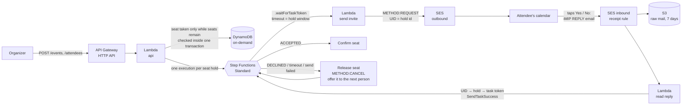
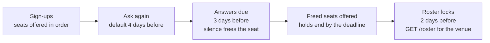

# Standby

**The waitlist that lives in your calendar.**

Small meetups fill up in minutes, then seats go empty on the day while the people on the
waitlist never hear back in time. Standby gives every seat to someone as a calendar invite and
lets their calendar's own **Yes / No** buttons decide what happens next:

- **Yes** — the seat is confirmed.
- **No**, or **no answer before the hold runs out** — the event disappears from their calendar
  and appears in the next person's.

Attendees never open a website, never log in, never click a link. Seats move from one calendar
to the next on their own. Everything is serverless and costs close to nothing while idle.

**Seats only move while it still helps.** Nobody rearranges their evening for a seat offered an
hour before the start, and venues often need the visitor list or printed badges a day or two
ahead. So every event has a **roster deadline** (default: two days before). Before it, Standby
asks the people who said Yes once more ("Still coming?"), frees the seats of anyone who doesn't
answer while the waitlist still has time to plan, and then locks the list for the venue. After
the deadline, seats stop moving.

## How it works



One Step Functions execution holds one seat. It sends the invite and then simply waits on a
task token, for as long as the hold window allows (minutes or days: Standard workflows, because
Express stops at five minutes). The attendee's RSVP comes back as an ordinary email, which SES
receives on a subdomain and a Lambda turns into `SendTaskSuccess`. No answer in time raises
`States.Timeout`, which releases the seat.

The seat count lives in DynamoDB and only changes inside a transaction whose condition is
`seated < capacity`, so the event can never be over-booked however many people sign up at once.
We measured what happens without that condition: see [results](results/README.md).

### The reusable part

The core trick, **a calendar RSVP as the callback of a serverless workflow**, is written up on its
own in [`patterns/calendar-rsvp-callback`](patterns/calendar-rsvp-callback/README.md), with the
pitfalls we hit. It fits anything where a person has to accept a slot: interview times, shift
cover, equipment bookings, delivery windows.

## What we measured

From [`results/README.md`](results/README.md):

- **Check-then-act vs a condition in the write**, 50 people for 30 seats, 10 trials each:
  the naive version gave out 28–31 seats and was wrong in 7 of 10 trials (oversold 4 times,
  left a seat empty 3 times). Standby gave exactly 30 every time.
- **Burst through the deployed API**: 50 sign-ups in about 5 s, exactly 30 seats held, 3 runs
  out of 3. When nobody answered, 150 holds expired and cascaded with 0 stuck or failed workflows.
- **Real calendars** (Google Calendar, Gmail and Workspace accounts): Yes confirmed the seat about
  1 s after the reply reached SES; No released it and invited the next person about 2 s later;
  silence expired the hold on time and removed the event from the calendar.

### One event's timeline



A second, per-event Step Functions execution waits until each of those times (`Wait` with a
timestamp, no scheduler), asks the confirmed attendees again, and locks the roster.

## Deploy it

You need: an AWS account, the AWS SAM CLI, and a domain (a subdomain is enough) whose DNS you can edit.
SES receiving is only available in some regions; this was built in `us-east-1`.

1. **Verify the domain in SES** (Easy DKIM) and add its three DKIM `CNAME` records.
2. **Point the subdomain's MX at SES inbound**: `standby.example.com  MX  10 inbound-smtp.us-east-1.amazonaws.com`.
   Use a subdomain so the parent domain's mail is untouched.
3. **While SES is in the sandbox**, verify every attendee address you want to invite. That also
   means nobody else can be invited by accident.
4. **Deploy**:

   ```sh
   sam build
   sam deploy --guided \
     --parameter-overrides MailDomain=standby.example.com \
       OrganizerEmail=host@standby.example.com ApiKey=<a long random string>
   ```

5. **Activate the receipt rule set** (one per region can be active; this replaces any other):

   ```sh
   aws ses set-active-receipt-rule-set --rule-set-name <ReceiptRuleSetName output>
   ```

There is no pipeline: `sam deploy` from your machine is the whole release process.

## Use it

```sh
export STANDBY_API=<ApiUrl output> STANDBY_API_KEY=<your key>

# an event with 2 seats and a 10-minute answer window
# (optional: reconfirm_at, reconfirm_by, roster_deadline; defaults are 4, 3 and 2 days before the start)
curl -s -X POST $STANDBY_API/events -H "x-standby-key: $STANDBY_API_KEY" \
  -d '{"title":"Serverless Night","starts_at":"2026-11-20T19:00:00+09:00",
       "ends_at":"2026-11-20T20:30:00+09:00","capacity":2,"hold_seconds":600}'

# people join in order; the first two get invites, the rest wait
curl -s -X POST $STANDBY_API/events/<event_id>/attendees -H "x-standby-key: $STANDBY_API_KEY" \
  -d '{"attendees":[{"email":"ada@example.org","name":"Ada"},{"email":"alan@example.org","name":"Alan"}]}'

# watch the seats move
scripts/board.sh <event_id>

# the final list for the venue, once locked
curl -s $STANDBY_API/events/<event_id>/roster -H "x-standby-key: $STANDBY_API_KEY"
```

Addresses on the reserved `example.com/.org/.net` domains are **simulated attendees**: they take
part in everything except email, which is how the load tests run without sending mail.

```sh
python3 tests/test_ical.py                              # parser and builder, no AWS needed
python3 scripts/burst.py --people 50 --capacity 30      # through the deployed API
TABLE_NAME=<table> python3 scripts/compare_seating.py   # naive vs conditional seating
```

## Limits, honestly

- Changes after the roster deadline are the venue's problem, not Standby's: a seat freed then
  stays empty.
- Tested with Google Calendar only. Other clients use the same standard (iMIP, RFC 6047) but
  have not been tried here.
- The organizer API uses one shared key. Fine for one organizer; a real product would want users.
- The board polls the API every 2 s; it is a demo view, not a product UI.
- Holds use `invited_at` to the second, so the countdown on the board can be off by a second.

## License

Apache License 2.0. Copyright ikenyal.
